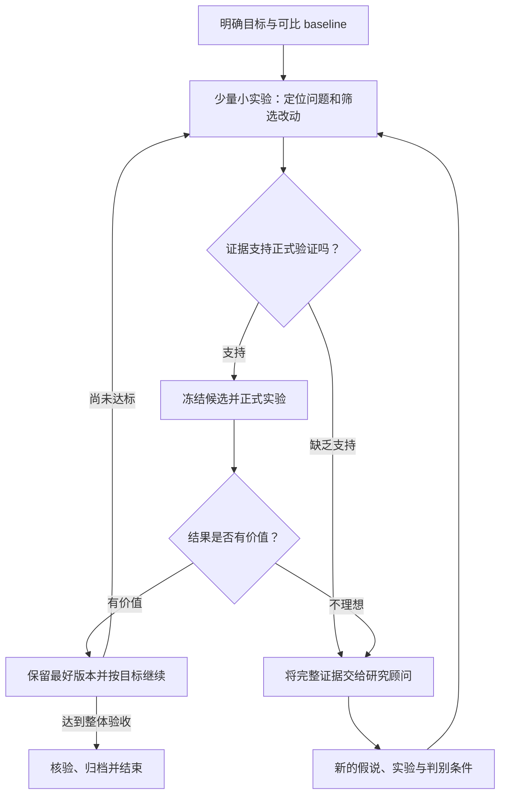

# Research Workflow

一个用于深度学习与计算实验研究的通用 Agent Skill，通过诊断、正式验证、顾问复审和方向调整，推进可追溯的实验迭代。

A reusable agent skill for evidence-driven research: diagnose cheaply, validate deliberately, preserve useful results, and change direction when evidence warrants it.

## 工作方式



- 小实验优先，用少量诊断筛选值得投入正式训练的改动。约三到四次是可调整的起点，不是硬性计数。
- 区分实现正确、获得学习机会、模型利用预期信息、任务收益和验收达标。
- 分别设置早期淘汰条件、阶段检查点与效果判断窗口，让关键机制获得合理验证机会。
- 同一假说反复无效时，先定位原因，再调整表达、监督、作用路径或研究方向。
- 保留有效版本；需要转入组合研究时，固定成功模块，把预算用于未解决的问题。
- 研究顾问可由 ChatGPT Pro 或其他模型承担；实验记录可采用项目指定的服务或本地系统。

## 安装到 Codex

将 `skills/research-workflow` 整个目录放入 Codex 已配置的技能目录。当前官方文档给出的用户级目录是 `~/.agents/skills`，项目级目录是 `.agents/skills`；已有安装应在原位置更新，避免出现同名重复项。参见 [OpenAI 技能文档](https://learn.chatgpt.com/docs/build-skills)。

在仓库根目录执行以下示例。

### macOS / Linux

```bash
mkdir -p ~/.agents/skills
cp -R skills/research-workflow ~/.agents/skills/
```

### Windows PowerShell

```powershell
$skillDestination = Join-Path $env:USERPROFILE '.agents\skills'
New-Item -ItemType Directory -Path $skillDestination -Force | Out-Null
Copy-Item -LiteralPath '.\skills\research-workflow' -Destination $skillDestination -Recurse
```

已有同名技能时，先检查并保留本地修改，再更新需要的文件。

## 使用

```text
使用 $research-workflow，结合当前研究目标、已有实验、预算和授权，推进下一轮迭代。
```

也可以指定只读分析：

```text
使用 $research-workflow，只读分析这轮实验为什么没有提升，提出能区分原因的小实验，不启动训练。
```

实际项目需要提供或从上下文读取：研究目标、baseline、正常评测口径、作用窗口、实验预算、资源边界与授权。技能不固定数据集、指标阈值、硬件编号、顾问账号或训练轮数，也不自动授予外部发送与公开发布权限。

## 文件

- [技能入口](skills/research-workflow/SKILL.md)：触发范围与核心流程。
- [实验决策](skills/research-workflow/references/experiment-decisions.md)：机制诊断、时间窗口、结果比较与转向条件。
- [顾问交接模板](skills/research-workflow/references/model-handoff.md)：任务卡、证据包、提问与结果汇报。
- [界面元数据](skills/research-workflow/agents/openai.yaml)：Codex 技能名称与默认提示。

此仓库只提供通用工作流与模板，不包含原始实验数据、聊天记录、模型权重或私人项目资料。

## 许可证

[MIT](LICENSE)。
